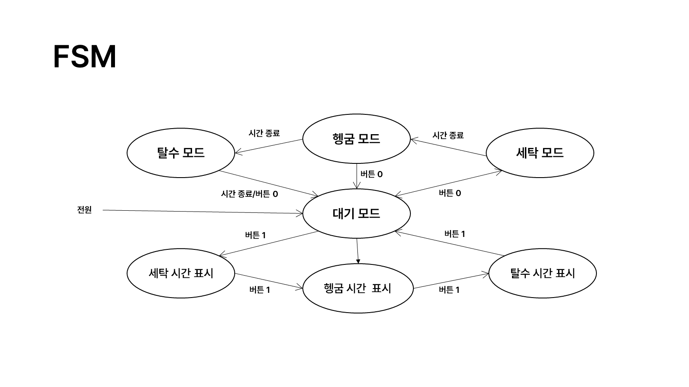
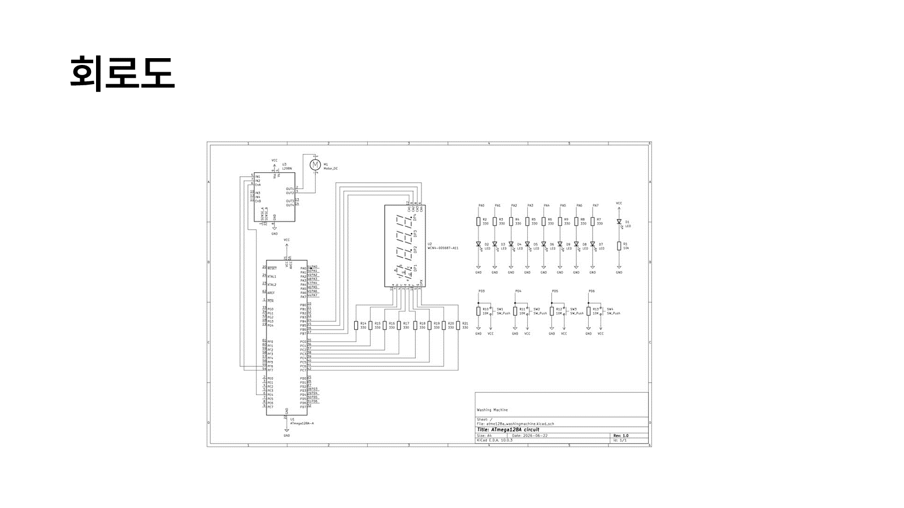

# 세탁기 동작 구현 (ATmega128A)

버튼과 타이머로 세탁 → 헹굼 → 탈수 순서를 제어하는 세탁기 동작 시뮬레이터. DC 모터 PWM 구동, 남은 시간 FND 표시, 현재 단계 LED 표시.

- **기간**: 2026-06-18 ~ 06-22
- **MCU**: ATmega128A (16MHz) · **언어**: C · **IDE**: Microchip Studio
- **형태**: 개인 프로젝트
- **발표 자료**: [PDF](docs/presentation.pdf)



## 주요 기능

| 기능 | 구현 내용 |
|---|---|
| 상태 머신 | `대기(STANDBY)` / `동작(WORKING)` / `설정(SETTING)` 3개 모드, 버튼 입력으로 전환 |
| 자동 순서 진행 | 동작 모드에서 세탁 → 헹굼 → 탈수 순으로 남은 시간 1초씩 감소, 탈수 종료 시 대기 모드 복귀 |
| DC 모터 제어 | Timer3 Fast PWM(OC3C)으로 속도, `PF6`/`PF7`로 회전 방향 제어 |
| 방향 전환 | 세탁·헹굼 단계에서 10초마다 정회전 ↔ 역회전 교대 |
| 시간 설정 모드 | 버튼으로 세탁 / 헹굼 / 탈수 설정 항목 순환 선택 |
| 표시 | FND: 동작 중 남은 시간, 설정 모드 설정값 / PORTA LED: 현재 단계 / UART0 `printf` 디버그 출력 |
| 버튼 처리 | 눌렀다 뗀 시점에 한 번만 인식하는 에지 검출, 15ms 디바운스 |

## 하드웨어

| 부품 | 용도 |
|---|---|
| ATmega128A | 메인 MCU |
| L298N + EZ-MOTOR R300 (DC 모터) | 세탁조 구동 |
| 4-Digit 7-Segment (WCN4-0056B7-A11) | 시간 표시 |
| 5mm LED(적색) × 8 | 단계 표시 |
| 택트 스위치 × 4 | 시작·정지, 설정 |



## 상태 머신

```
              BTN0               시간 종료           시간 종료           시간 종료
 대기 ───────────────▶ 세탁 ─────────────▶ 헹굼 ─────────────▶ 탈수 ─────────────▶ 대기
  │ ◀── BTN0 (동작 중 언제든 정지) ──────────────────────────────────────────┘
  └─ BTN1 ─▶ 세탁 시간 설정 ─ BTN1 ─▶ 헹굼 시간 설정 ─ BTN1 ─▶ 탈수 시간 설정 ─ BTN1 ─▶ 대기
```

## 코드 구조

```
src/
├── main.c      초기화, 메인 루프(button_event → machine_processing)
├── common.h    상태 머신 자료형 (MODE, WORKING_OPTION, WASHING_MACHINE)
├── button.c    버튼 에지 검출, 모드 전환
├── time.c      Timer0 1ms 인터럽트, 남은 시간 계산, 방향 토글 타이밍
├── pwm.c       Timer3 PWM, 모터 방향/구동
├── fnd.c       FND 다이나믹 표시
├── led.c       단계 표시 LED
└── uart0.c     디버그용 UART
hardware/kicad/ 회로도 (KiCad)
docs/           발표 자료(PDF), 슬라이드 이미지
```

## 빌드

- Microchip Studio: `src/05.MOTOR_PWM_WASHINGMACHINE_ver5.cproj` 열어서 빌드
- avr-gcc:

```bash
avr-gcc -mmcu=atmega128a -Os -I src -o washing.elf src/*.c
```

## 개발 메모

- 보드 동작 확인한 최종 버전(ver5). 이전 버전(ver2~ver4)은 미포함
